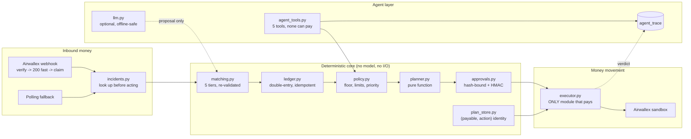

# Closebook

Continuous treasury and payments for a cross-border SME, built on the Airwallex
sandbox.

The demo business is **Kano Craft Imports Ltd**, a Lagos importer paid by
customers in USD and GBP who pays suppliers in EUR and USD.

> **The model proposes; deterministic code enforces.**
> Amounts, limits, approvals, the reserve floor, idempotency and duplicate
> protection are decided in code — never by a language model. A model may read a
> messy bank reference and explain a decision. It cannot authorise a payment,
> choose an amount, or mark money as matched.

---

## What the agent does vs what code enforces

| | The agent (model) | Code (deterministic) |
|---|---|---|
| **Invoices** | May *propose* which invoice a payment belongs to | `matching.py` re-derives every allocation and escalates on any mismatch |
| **Amounts** | Never sets one | `policy.py` owns every value; minor units internally |
| **Approvals** | May *request* one; can never self-approve | `approvals.py` binds a SHA-256 hash of exact terms, HMAC-signed |
| **Payments** | Has **no tool that can pay** | `executor.py` is the only module that moves money |
| **Failures** | May explain one to a human | `incidents.py` looks the transfer up on Airwallex before deciding |
| **Reserve floor** | Never sees or changes it | `policy.py` defers, never trims, a payout that breaches it |
| **Duplicates** | — | `plan_store.py` makes `(payable, action)` a payment's identity |

The agent is given five tools — `list_open_invoices`, `propose_match`,
`explain_decision`, `request_approval`, `read_plan`. There is no payment tool, so
it cannot express a payment even if it wanted to. That is a stronger guarantee
than a policy check that could be mis-ordered or bypassed.

---

## What each beat demonstrates

| Beat | What happens |
|---|---|
| 1 | Plan the day. Real planner, real budget. Small USD payouts auto-pay; the big EUR payout needs a human. |
| 2 | A USD 12,000 deposit arrives with a typo'd reference (`inv 0O41 brightline`) and matches `INV-0041` anyway. That unlocks `PO-7001`. |
| 3 | A GBP 4,800 part-payment matches partially — and the dependent payable **stays held**. A part payment is not a settlement. |
| 4 | Policy verdict: a 7,000.01 authorisation is declined by the inclusive 7,000 limit. **Not a live card decline** — see the caveat below. |
| 5 | A payout fails. Closebook looks the transfer up on Airwallex before deciding anything, and proposes a **replacement under a duplicate lock with a new request id**. It never auto-pays twice. |
| 6 | A USD 4,400 deposit arrives from `L. Stores` with **no reference at all**. The model proposes it against `INV-0043` and asserts **0.85 confidence**. Code re-derives every number, applies it, and — because the invoice was 4,500 — leaves **100.00 USD still outstanding**. The result is pinned to the approval band: *a model's own score can never clear a payment.* The page shows the model's claim and code's decision side by side. |
| 7 | Reconciled double-entry ledger, unapplied cash shown, reserve floor respected. |

### The model does not grade its own work

The model writes a confidence number. It is **its claim, not the verdict**, and
it is displayed as such. `MATCH_CONFIDENCE_AUTO` is 0.90 and code caps *any*
model-sourced result at **0.89** (`matching._LLM_MAX_CONFIDENCE`), so an LLM
proposal can be applied and recorded but can never reach the automatic band —
regardless of what number it asserts about itself. A test sweeps 0.90–1.00 to
prove the claim alone would have been AUTO, while the actual result is not.

### Every transfer here is sandbox money

Closebook really does move money through the Airwallex **sandbox** — a real API
call, a real transfer object, a real status — but **no real funds are involved
and no money can leave this demo**. Where the app shows a payment, it shows the
status Airwallex reports *right now* (`dashboard.live_transfer_statuses()`),
not what Closebook recorded. A step we submitted is `SUBMITTED`; only the bank
can make it `PAID`. The EUR 9,012.85 Rotterdam Freight transfer currently reads
**PROCESSING** in the sandbox.

### Honest scope on beat 4

Beat 4 reports **Closebook's policy verdict**, not a real card-network decline.
Live card issuance was retried with the commercial program after an earlier
`CONSUMER` rejection, and the payload is now correct: `program.purpose:
COMMERCIAL`, `issue_to: ORGANISATION`, `is_personalized`, limits nested under
`authorization_controls`, and no `primary_contact_details` (the docs still show
it, but the API rejects it as unsupported). **Cardholder creation succeeds** and
returns `READY`, so credentials and the endpoint are fine.

Card creation still fails with `invalid_request: Invalid issuance details`, and
the same account returns *"Admin permissions required"* for `/issuing/balances`
and `/issuing/programs` — an account-level issuing restriction, not a payload
bug. The simulation endpoint requires a real `card_id`, so there is nothing to
authorise against. No card was issued and no decline was returned by Airwallex. A
synthetic decline would not be evidence that our policy is enforced, so it is not
described as one.

---

## Setup

Requires Python 3.11+.

```bash
git clone https://github.com/cipoklean/closebook.git
cd closebook
make setup          # venv + deps; copies .env.example -> .env on first run
```

Then fill in `.env` (see below). **An LLM key is optional** — with none set,
matching, policy and planning run fully deterministically.

```bash
make test           # 324 tests, hermetic — no secrets or network needed
make seed           # creates sandbox global accounts, deposits scenario cash
make dev            # site on http://127.0.0.1:8000/ and app on /app
make demo           # the 7 beats, deterministic decisions only
make webhook-url    # ngrok pinned to the reserved static domain
```

### Environment variables

Exactly as `backend/app/config.py` reads them (pydantic-settings loads `.env`):

| Variable | Required | Purpose |
|---|---|---|
| `AWX_CLIENT_ID` | for live | Airwallex sandbox client id |
| `AWX_API_KEY` | for live | Airwallex sandbox API key |
| `AWX_BASE_URL` | no | Fixed to the sandbox host; non-sandbox values are rejected at startup |
| `AWX_WEBHOOK_SECRET` | to accept webhooks | HMAC secret. **If empty, every webhook is rejected (400)** — deliberate: an unauthenticated webhook endpoint is a payment-injection risk |
| `AWX_ALLOW_TEST_EVENTS` | no | `true` accepts sandbox test events that carry the secret in a `client-secret-key` header. Default `false` |
| `CLOSEBOOK_HMAC_SECRET` | to sign approvals | Signs the approval-bundle hashes. **An empty value fails at first real use** while unit tests still pass |
| `DEMO_APPROVER_PIN` | to use the approval UI | Shared PIN for `POST /approvals/...`. If unset the endpoint is **closed**, not open |
| `LLM_API_KEY` | no | Any OpenAI-compatible endpoint |
| `LLM_BASE_URL` | no | Defaults to `https://api.openai.com/v1` |
| `LLM_MODEL` | no | Defaults to `gpt-4o-mini` |
| `PUBLIC_BASE_URL` | for webhooks | Where FastAPI is reachable |
| `WEBHOOK_PATH` | no | Defaults to `/webhooks/airwallex` |
| `LOG_LEVEL` | no | Defaults to `INFO` |

`CLOSEBOOK_HMAC_SECRET` can be generated with:

```bash
python -c "import secrets; print(secrets.token_hex(32))"
```

### Does `make demo` need the network?

**No.** `make demo` prints the deterministic decisions for all seven beats and
works offline. It does not call Airwallex.

To execute the beats against the sandbox instead:

```bash
cd backend
../.venv/bin/python -m app.seed.live_beats
```

That needs `AWX_CLIENT_ID` and `AWX_API_KEY`. Beats are **idempotent** — running
twice gives identical balances, which is checked on purpose.

### The probes

Each of these proved a real API assumption rather than assuming one:

```bash
.venv/bin/python scripts/verify_rate_convention.py      # FX round trip
.venv/bin/python scripts/probe_beneficiary_schema.py    # live schema
.venv/bin/python scripts/probe_webhook_recovery.py      # signed webhook end to end
```

---

## Architecture



The important edge is the one that does **not** exist: the agent layer has no
arrow into `executor.py`. Money moves only when deterministic code says so.

---

## The parts that matter most

**Money movement is idempotent by construction.** Every payout has a durable
`plan_step` row whose `request_id` is written to the database *before* the API
call. A step that already carries an `airwallex_object_id` is never sent again. A
step left `SUBMITTED` by a crash is resolved by **looking the request up on
Airwallex**, not by re-sending it.

**Approvals are bound to exact terms.** The SHA-256 hash covers amount, currency,
counterparty, supplier, invoice ids, quote id and the normalised FX rate, and is
HMAC-signed so we can prove *this* Closebook issued it. Change any bound term by
a single cent and the approval is void.

**A failure webhook is a claim, not proof.** `payout.transfer.failed` triggers a
lookup. If the transfer is still `PROCESSING`, Closebook watches it and creates
**nothing** — because a replacement could double-pay a transfer that has not
settled yet. Webhooks are also rejected unless the timestamp is within five
minutes, and an event with no id is refused so dedupe cannot be bypassed.

**The treasury runs on its own committed-cash budget, not the sandbox balance.**
Airwallex prefunding is *capacity*. Policy is measured against
`settings/committed_cash.json`. This is why a payout can be correctly refused
for breaching the reserve floor while the sandbox still shows millions.

**No paid LLM is required.** `backend/app/domain/llm.py` is optional. With no
API key set, matching runs fully deterministically and explanations fall back to
the deterministic reason. Offline is a supported mode, not a degraded one.

---

## Layout

```
backend/app/
  domain/         pure logic — no I/O, fully unit-tested
    matching.py     5-tier invoice matcher
    ledger.py       double-entry, idempotent postings
    policy.py       reserve floor, limits, committed cash, priority
    planner.py      deterministic treasury planner
    executor.py     THE ONLY MODULE THAT MOVES MONEY
    approvals.py    hash-bound, HMAC-signed approvals
    plan_store.py   plan-step identity (payable, action)
    incidents.py    failure classification and recovery decisions
    agent_tools.py  the 5-tool agent and its trace
    llm.py          optional, offline-safe model layer
    approval_api.py PIN-gated human approval
  airwallex/      one module per API surface, each verified live
  seed/           the demo scenario and its two drivers
  ui.py           server-rendered pages (hand-written, no build step)
  dashboard.py    one read-only context pass
  static/         the stylesheet (design tokens)
docs/
  ENGINEERING_NOTES.md   key decisions and gotchas
  design/                the approved mockup, treated as the visual spec
scripts/          live probes that verify real API assumptions
tests/            324 tests
```

---

## Webhooks

Webhooks are **optional**; polling is the supported fallback.

With `AWX_WEBHOOK_SECRET` unset the receiver rejects everything, which is
correct. Set it, or set `AWX_ALLOW_TEST_EVENTS=true` to accept sandbox test
events that carry the secret per request.

Delivery is at-least-once, so events are deduped on `event_id`, bounded by a
five-minute replay window, and **claimed atomically** so two background tasks
cannot both process the same event. The endpoint acknowledges immediately and
processes in the background.

---

## The UI

Two server-rendered pages, no build step and no JS framework:

| URL | What it is |
|---|---|
| `/` | The landing page — hero, problems, how it works, safety, features, who it's for, built on, closing CTA, footer. Illustrative copy; **no live figures.** |
| `/app` | The operator app — Home, Money in, Money out, Needs your OK (with a live count badge), AI activity. Sidebar on desktop, bottom tab bar under 768px. |

The visual spec is `docs/design/closebook-mockup.html`: `#F6F7F9` ground, white
cards, `#5B5BD6` accent, Inter, with system-font fallback so a blocked Google
Fonts never leaves the page unstyled. Tokens live in
`backend/app/static/closebook.css` and are shared by both pages.

**Every number on `/app` comes from the dashboard context** (`build_context()`),
which reads the same ledger, plan, incident and trace rows the JSON endpoints
expose. The page never computes a decision — it renders what code already
decided. Labels map onto the real fields:

| On screen | Source |
|---|---|
| Cash you have | ledger cash |
| Cash set aside | committed cash, with the reserve floor |
| Money we couldn't match | unapplied / suspense |
| Automatic limit | the auto-pay limit |
| Today's checklist | treasury plan rows, as sentences |
| The step tracker | each payable's real plan-step state |
| AI activity | `agent_trace` rows |

A few deliberate UI rules, each of which is a bug that shipped once:

- **A failed or stale step is never shown as approvable.** Terminal steps, and
  steps naming no amount, render as a **Problem** with the reason — not as a
  0.00 "approve" card.
- **Incidents are grouped by transfer.** One transfer is one card with its
  events listed inside; the newest event sets the header, so a transfer that
  failed and then settled reads as settled.
- **An action with no endpoint is disabled and says "Coming soon."** The UI does
  not invent endpoints that move money.
- **Approve/Decline posts to the existing `/approvals/{id}/approve|reject`**
  and shows the real result, including a refused PIN.

---

## Troubleshooting

**"The app could not read state."** Check `make test` still passes, then
check the DB. The page falls back deliberately rather than showing wrong numbers.

**"DEMO_APPROVER_PIN is not configured."** The approval endpoint is closed until
you set it. That is the secure default, not a bug.

**Every webhook is rejected.** `AWX_WEBHOOK_SECRET` is empty. Set it, or use
`AWX_ALLOW_TEST_EVENTS=true` for sandbox test events.

**A payout says it is already done.** That is the duplicate guard working. Look
at `/state` and the plan table.

**Everything is refused.** Check `settings/committed_cash.json` — with
USD 40,000 committed and a USD 5,000 floor, a USD 36,000 payout is correctly
refused. That is the point.

**Approval signing raises.** `CLOSEBOOK_HMAC_SECRET` is empty. Unit tests pass
anyway because `conftest.py` supplies its own, so this only appears on a live
path.

---

## Notes

- Airwallex **sandbox only**. No real funds can move; a non-sandbox host is
  rejected at startup.
- Internal money is integer **minor units**; Airwallex receives major-unit strings.
- Raw sandbox balances are capacity. Policy runs on the committed-cash budget.

[](https://github.com/cipoklean/closebook/actions/workflows/test.yml)
