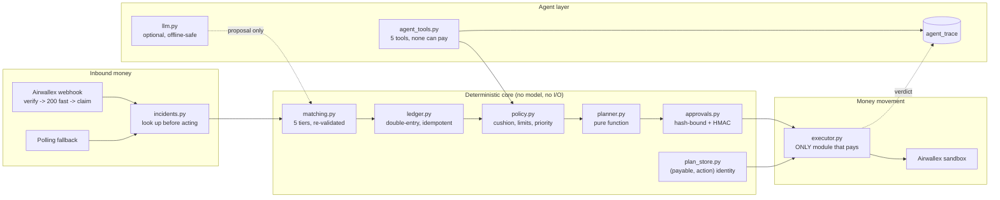

# Closebook

[](https://github.com/cipoklean/closebook/actions/workflows/test.yml)

**A reconciliation agent for a cross-border business on Airwallex. It matches
every payment that lands to the invoice it pays, then decides which supplier
bills that money may now pay, and it never pays twice.**

Built for the Airwallex Agentic Banking Hackathon, on the Airwallex sandbox.

> **The model proposes; code decides.**
> Amounts, limits, approvals, the safety cushion, idempotency and duplicate
> protection live in code, never in a language model. A model may read a messy
> bank reference and explain a decision. It cannot authorise a payment, choose
> an amount, or mark money as matched.

---

## What it does

1. **Money in.** A deposit lands on an Airwallex global account (webhook, with
   polling as the fallback). Closebook matches it to an open invoice through
   five tiers: exact, rule, multi-invoice, part-payment, then a model for the
   messy cases. Code re-checks every proposal before anything is applied.
2. **Money out.** Each deposit re-plans the supplier bills it unlocks. A bill is
   paid automatically only when every rule passes: the match is confident, the
   currency can be priced, the amount is within the auto-pay limit, and the
   safety cushion stays untouched. Anything else waits for a person.
3. **A person decides the rest.** Unclear deposits, over-limit bills, refunds
   and repeats land in *Needs your OK* with the reason in plain words.
   Approvals are bound by hash to the exact terms and PIN-gated.
4. **The bank has the last word.** A transfer is "Sent, awaiting bank" until
   Airwallex says it is paid. A failure webhook triggers a lookup, never a blind
   re-send.
5. **Cards enforce the same limit.** A virtual card issued on Airwallex carries
   the auto-pay limit as its per-transaction limit, so the bank itself refuses
   what the rules refuse (see "Card issuing" below).

A **Pause** switch on Home stops the AI from acting at once: matches become
proposals and clear payments wait. Resuming needs the PIN.

---

## What the agent does vs what code enforces

| | The agent (model) | Code (deterministic) |
|---|---|---|
| **Invoices** | May *propose* which invoice a payment belongs to | `matching.py` re-derives every allocation and escalates on any mismatch |
| **Amounts** | Never sets one | `policy.py` owns every value; minor units internally |
| **Approvals** | May *request* one; can never self-approve | `approvals.py` binds a SHA-256 hash of exact terms, HMAC-signed |
| **Payments** | Has **no tool that can pay** | `executor.py` is the only module that moves money |
| **Failures** | May explain one to a human | `incidents.py` looks the transfer up on Airwallex before deciding |
| **Safety cushion** | Never sees or changes it | `policy.py` defers, never trims, a payout that breaches it |
| **Duplicates** | none | `plan_store.py` makes `(payable, action)` a payment's identity; a repeat deposit is flagged and held |

The agent is given five tools: `list_open_invoices`, `propose_match`,
`explain_decision`, `request_approval`, `read_plan`. There is no payment tool,
so it cannot express a payment even if it wanted to. Constructing the agent
with one raises.

### The model does not grade its own work

The model writes a confidence number. It is **its claim, not the verdict**.
The automatic bar (`MATCH_CONFIDENCE_AUTO`) is 0.90, and code caps *any*
model-sourced result at **0.89** (`matching._LLM_MAX_CONFIDENCE`), so a model
proposal can be shown and approved but can never clear money on its own. A test
sweeps 0.90 to 1.00 to prove it.

### Default limits

A fresh book starts with a **USD 5,000 safety cushion** (cash the planner never
spends) and a **USD 2,500 auto-pay limit** (anything above it needs your OK).
Both are editable in Setup, behind the PIN.

### Every transfer here is sandbox money

Closebook makes real Airwallex **sandbox** calls: real transfer objects, real
statuses, no real funds. A non-sandbox host is rejected at startup. Where the
app shows a payment, it shows the status Airwallex reports.

---

## Try it in five minutes

Open `/app` and follow the three-step guide on Home, or:

1. **Setup:** add a customer and an invoice, `INV-1001` for USD 8,000. Add a
   supplier (the form shows a beneficiary input Airwallex accepts) and a bill of
   USD 1,800 set to pay only after `INV-1001`.
2. **Money in:** simulate a USD 8,000 deposit with a messy reference such as
   `inv 1oo1`. It matches `INV-1001`, and the bill it unlocks is planned.
3. **Money out:** USD 8,000 in, minus the USD 5,000 cushion, leaves USD 3,000
   free, so the USD 1,800 bill is within every rule and is sent. It reads
   "Sent, awaiting bank" until Airwallex reports it paid. A bill over USD 2,500
   would wait in *Needs your OK* for the PIN instead.
4. Send the same deposit again: it is flagged as a repeat and held, not applied
   twice. Open **AI decisions** to see each suggestion, the rule checks and the
   result side by side.

---

## Card issuing

The books run on a sandbox registered in Nigeria, which is not an issuing
region, so card creation there returns `Invalid issuance details`. Airwallex
confirmed the cause, and Closebook uses a **second sandbox registered in Hong
Kong for cards only** (`AIRWALLEX_ISSUING_CLIENT_ID` / `AIRWALLEX_ISSUING_API_KEY`).

Live result, 29 Oct 2026, on a virtual card whose per-transaction limit is the
auto-pay limit:

| Authorisation | Airwallex's answer |
|---|---|
| USD 2,500.00 | `APPROVED` |
| USD 2,500.01 | `DECLINED`, `LIMIT_EXCEEDED` |

That is the bank's decline, not a staged failure. Without issuing keys the app
still runs and says the card check is a policy verdict only. Full history and
evidence: `docs/AIRWALLEX_CARD_ISSUING_REQUEST.md`; reproduce with
`scripts/probe_issuing_hk.py`.

---

## Setup

Requires Python 3.11+.

```bash
git clone https://github.com/cipoklean/closebook.git
cd closebook
make setup          # venv + deps; copies .env.example -> .env on first run
```

Then fill in `.env` (see below). **An LLM key is optional**: with none set,
matching, policy and planning run fully deterministically.

```bash
make test           # 1,198 tests, hermetic, no secrets or network needed
make dev            # site on http://127.0.0.1:8000/ and the app on /app
make webhook-url    # public URL for the Airwallex webhook
make test-e2e       # browser tests (needs: playwright install chromium)
```

### Environment variables

Exactly as `backend/app/config.py` reads them (pydantic-settings loads `.env`):

| Variable | Required | Purpose |
|---|---|---|
| `AWX_CLIENT_ID` | for live | Airwallex sandbox client id (the books) |
| `AWX_API_KEY` | for live | Airwallex sandbox API key (the books) |
| `AWX_BASE_URL` | no | Fixed to the sandbox host; non-sandbox values are rejected at startup |
| `AWX_WEBHOOK_SECRET` | to accept webhooks | HMAC secret. **If empty, every webhook is rejected (400)**, deliberately: an unauthenticated webhook endpoint is a payment-injection risk |
| `AWX_ALLOW_TEST_EVENTS` | no | `true` accepts sandbox test events that carry the secret in a `client-secret-key` header. Default `false` |
| `AIRWALLEX_ISSUING_CLIENT_ID` | for cards | Client id of the Hong Kong sandbox used only for card issuing |
| `AIRWALLEX_ISSUING_API_KEY` | for cards | Its API key. Empty means no card client; the app still runs |
| `CLOSEBOOK_HMAC_SECRET` | to sign approvals | Signs the approval-bundle hashes. **An empty value fails at first real use** while unit tests still pass |
| `DEMO_APPROVER_PIN` | to approve | PIN for approvals, Resume and Setup changes. If unset those routes are **closed**, not open |
| `OPERATOR_NAME` | no | Stamped on every decision row. Defaults to `david` |
| `WALKTHROUGH_URL` | no | An https link to a walkthrough video, shown at the top of Home. Empty hides it |
| `LLM_API_KEY` | no | Any OpenAI-compatible endpoint |
| `LLM_BASE_URL` | no | Defaults to `https://api.openai.com/v1` |
| `LLM_MODEL` | no | Defaults to `gpt-4o-mini` (the live demo uses NVIDIA Build) |
| `LLM_FALLBACK_MODEL` | no | Tried on a 5xx or timeout |
| `PUBLIC_BASE_URL` | for webhooks | Where FastAPI is reachable |
| `WEBHOOK_PATH` | no | Defaults to `/webhooks/airwallex` |
| `CLOSEBOOK_WORKSPACES` | no | `1` gives each visitor an isolated book via `/app?ws=<name>` |
| `CLOSEBOOK_DEV_ROUTES` | no | `1` enables the PIN-gated sandbox transfer transition route |
| `CLOSEBOOK_AUTO_EXECUTE` | no | `0` turns off automatic payouts entirely |
| `LOG_LEVEL` | no | Defaults to `INFO` |

`CLOSEBOOK_HMAC_SECRET` can be generated with:

```bash
python -c "import secrets; print(secrets.token_hex(32))"
```

### The probes

Each of these proved a real API assumption rather than assuming one:

```bash
.venv/bin/python scripts/verify_rate_convention.py      # FX round trip
.venv/bin/python scripts/probe_beneficiary_schema.py    # live schema
.venv/bin/python scripts/probe_webhook_recovery.py      # signed webhook end to end
.venv/bin/python scripts/probe_issuing_hk.py            # card approve + decline on the HK sandbox
```

---

## Architecture



The important edge is the one that does **not** exist: the agent layer has no
arrow into `executor.py`. Money moves only when deterministic code says so.

---

## The parts that matter most

**Money movement is idempotent by construction.** Every payout has a durable
`plan_step` row whose `request_id` is written to the database *before* the API
call. A step that already carries an `airwallex_object_id` is never sent again. A
step left `SUBMITTED` by a crash is resolved by **looking the request up on
Airwallex**, not by re-sending it.

**Approvals are bound to exact terms.** The SHA-256 hash covers amount, currency,
counterparty, supplier, invoice ids, quote id and the normalised FX rate, and is
HMAC-signed so we can prove *this* Closebook issued it. Change any bound term by
a single cent and the approval is void.

**A failure webhook is a claim, not proof.** `payout.transfer.failed` triggers a
lookup. If the transfer is still `PROCESSING`, Closebook watches it and creates
**nothing**, because a replacement could double-pay a transfer that has not
settled yet. Webhooks are also rejected unless the timestamp is within five
minutes, and an event with no id is refused so dedupe cannot be bypassed.

**One basis for affordability.** `policy.available_cash_minor` is ledger cash in
the budget currency, minus money already in flight, minus what this run has
already promised, minus the safety cushion. The planner and the Home figures
call the same function, so they cannot disagree. Raw sandbox balances are
capacity, not the business's cash: a payout can be correctly refused for
breaching the cushion while the sandbox still shows millions.

**No paid LLM is required.** `backend/app/domain/llm.py` is optional. With no
API key set, matching runs fully deterministically and explanations fall back to
the deterministic reason. Offline is a supported mode, not a degraded one.

---

## Layout

```
backend/app/
  domain/         pure logic, unit-tested
    matching.py     5-tier invoice matcher
    intake.py       one path for webhook, poll and simulated deposits; repeat detection
    ledger.py       double-entry, idempotent postings
    policy.py       safety cushion, limits, available cash, priority
    planner.py      deterministic treasury planner
    conductor.py    re-plans when money lands; honours Pause
    executor.py     THE ONLY MODULE THAT MOVES MONEY
    approvals.py    hash-bound, HMAC-signed approvals
    plan_store.py   plan-step identity (payable, action)
    incidents.py    failure classification and recovery decisions
    cards.py        card authorisations and the bank's verdict
    agent_tools.py  the 5-tool agent and its trace
    llm.py          optional, offline-safe model layer
    approval_api.py PIN-gated human approval
  airwallex/      one module per API surface, each verified live (incl. issuing.py)
  workspaces.py   isolated books per visitor (?ws=)
  ui.py, ui_home.py  server-rendered pages, no build step
  dashboard.py    one read-only context pass
  static/         stylesheet and self-hosted fonts
docs/
  ENGINEERING_NOTES.md               key decisions and gotchas
  AIRWALLEX_CARD_ISSUING_REQUEST.md  the issuing blocker and its fix
scripts/          live probes that verify real API assumptions
tests/            1,202 unit and integration tests; tests/e2e for the browser
```

---

## Webhooks

Webhooks are **optional**; polling is the supported fallback.

With `AWX_WEBHOOK_SECRET` unset the receiver rejects everything, which is
correct. Set it, or set `AWX_ALLOW_TEST_EVENTS=true` to accept sandbox test
events that carry the secret per request.

Delivery is at-least-once, so events are deduped on `event_id`, bounded by a
five-minute replay window, and **claimed atomically** so two background tasks
cannot both process the same event. The endpoint acknowledges immediately and
processes in the background.

---

## The UI

Server-rendered pages, no build step and no JS framework:

| URL | What it is |
|---|---|
| `/` | The landing page. Its one live figure is counted from the running book; a fresh book says it is empty rather than inventing a result. |
| `/app` | The operator app: **Home**, **Money in**, **Money out**, **Needs your OK** (with a live count), **AI decisions**, **Setup**. Sidebar on desktop, bottom tab bar on a phone. |

Home answers three questions first: how much is free to spend, what needs you,
and what the AI may do right now (with the Pause switch). Below that, the
latest money-in and money-out decisions show the AI's suggestion, each named
rule check with a tick or a cross, and the result; anything stopped by the
rules gets its own card, and the timeline is newest first.

**Every number on `/app` comes from the dashboard context** (`build_context()`),
which reads the same ledger, plan, incident and trace rows the JSON endpoints
(`/state`, `/state/tiles`, `/incidents`, `/approvals/pending`) expose. The page
never computes a decision; it renders what code already decided.

A few UI rules, each of which is a bug that shipped once:

- **A failed or stale step is never shown as approvable.** It renders as a
  problem with the bank's reason, not as a 0.00 "approve" card.
- **"Sent" is not "Paid".** A transfer reads "Sent, awaiting bank" until
  Airwallex reports it paid.
- **Incidents are grouped by transfer.** The newest event sets the header, so a
  transfer that failed and then settled reads as settled.
- **Approve and Decline post to `/approvals/{id}/approve|reject`** and show the
  real result, including a refused PIN.

---

## Troubleshooting

**"The app could not read state."** Check `make test` still passes, then
check the DB. The page falls back deliberately rather than showing wrong numbers.

**"DEMO_APPROVER_PIN is not configured."** Approvals, Resume and Setup changes
are closed until you set it. That is the secure default, not a bug.

**Every webhook is rejected.** `AWX_WEBHOOK_SECRET` is empty. Set it, or use
`AWX_ALLOW_TEST_EVENTS=true` for sandbox test events.

**A payout says it is already done.** That is the duplicate guard working. Look
at `/state` and the plan table.

**Nothing is paid.** Check the safety cushion and auto-pay limit in Setup. With
USD 6,000 of cash and a USD 5,000 cushion, a USD 1,800 bill correctly waits for
cash. That is the point.

**Approval signing raises.** `CLOSEBOOK_HMAC_SECRET` is empty. Unit tests pass
anyway because `conftest.py` supplies its own, so this only appears on a live
path.

---

## Notes

- Airwallex **sandbox only**. No real funds can move; a non-sandbox host is
  rejected at startup.
- Internal money is integer **minor units**; Airwallex receives major-unit strings.
- Raw sandbox balances are capacity. Policy runs on ledger cash minus the safety cushion.

